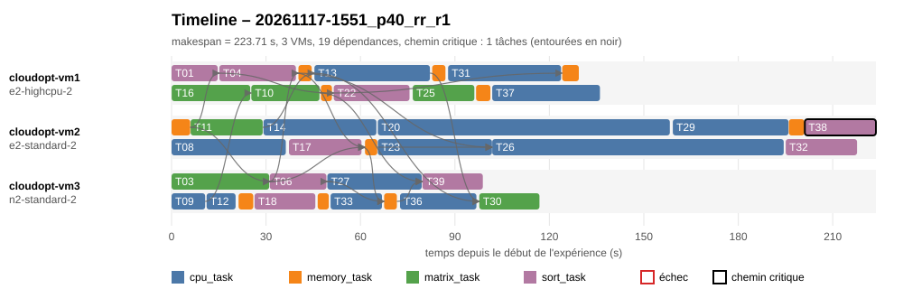
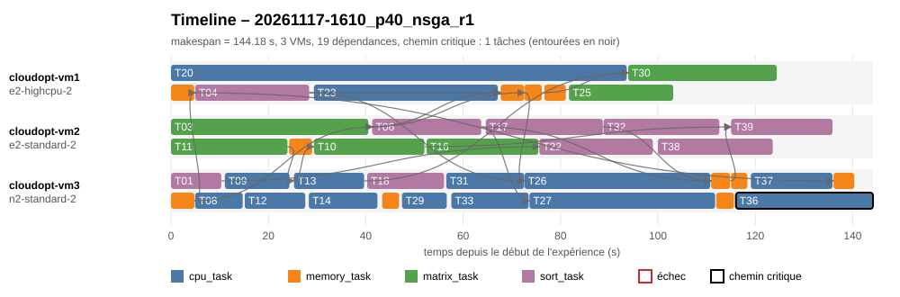
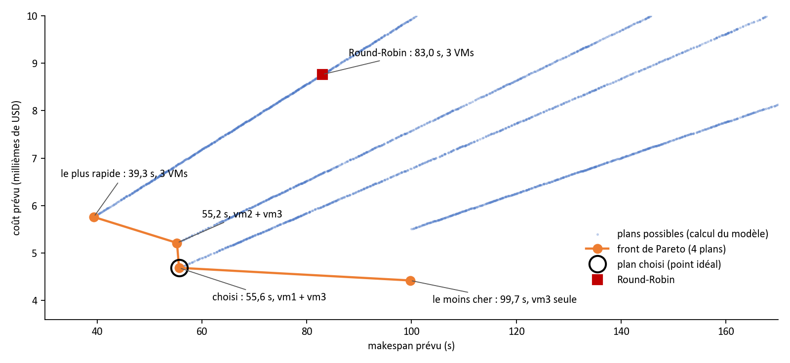

# Cloud Optimization - Placer des tâches sur GCP avec un algorithme génétique (NSGA-II)

Projet semestriel ESILV A4-CCC1, novembre 2026 - Maxime, Ali, Théotime.

**La question :** on a des tâches à exécuter et 3 VMs Google Cloud différentes (vitesse, mémoire, prix).
Sur quelle VM lancer chaque tâche pour finir vite **et** payer peu ?

**Ce qu'on a fait :** un **algorithme génétique multi-objectif (NSGA-II)**, codé en Go, qui optimise
en même temps le temps total (makespan) et le coût. On l'a comparé à deux baselines (Round-Robin et
un glouton HEFT) en exécutant vraiment les allocations sur de vraies VMs GCP, 3 runs par stratégie.

## Par où commencer

| Quoi | Fichier |
|---|---|
| Le rapport complet (11 parties) | [docs/rapport_cloud_optimization.docx](docs/rapport_cloud_optimization.docx) |
| **L'algorithme génétique NSGA-II** | [scheduler/nsga2.go](scheduler/nsga2.go) |
| Le modèle qui évalue un plan sans lancer de VM | [model/model.go](model/model.go) (tests : [model/model_test.go](model/model_test.go)) |
| Les résultats réels sur GCP | [data/campagne_17-11/BILAN.md](data/campagne_17-11/BILAN.md) puis [data/campagne/BILAN.md](data/campagne/BILAN.md) |
| Les baselines | [scheduler/round_robin.go](scheduler/round_robin.go), [scheduler/greedy.go](scheduler/greedy.go) |
| L'orchestrateur (exécution sur les VMs) | [scripts/run_experiment.sh](scripts/run_experiment.sh), [scripts/run_all_dag.sh](scripts/run_all_dag.sh) |
| Le format de tous les fichiers échangés | [docs/INTERFACES.md](docs/INTERFACES.md) |
| Le sujet | [SemestralProject.pdf](SemestralProject.pdf) |

## Résultat principal

40 tâches avec dépendances, 17/11 à Paris, 3 VMs (e2-highcpu-2, e2-standard-2, n2-standard-2),
3 runs par stratégie, 0 échec ([BILAN, section 4](data/campagne_17-11/BILAN.md)) :

| Stratégie | Makespan (3 runs) | Moyenne | Coût moyen |
|---|---|---|---|
| Round-Robin | 223,7 / 223,5 / 222,3 s | 223,2 s | 0,01860 USD |
| Glouton (HEFT) | 150,1 / 144,3 / 144,6 s | 146,4 s | 0,01331 USD |
| **NSGA-II (algorithme génétique)** | 144,2 / 147,2 / 141,9 s | **144,4 s** | **0,01318 USD** |

- **NSGA-II est 35 % plus rapide et 29 % moins cher que Round-Robin**, et au niveau du glouton.
- Sur 12 tâches, il trouve des plans **34,5 % moins chers** que Round-Robin, avec 2 VMs au lieu de 3.
- Limite principale : NSGA-II n'est jamais meilleur que ses mesures. Un même type de VM peut tomber
  sur un autre processeur d'un jour à l'autre (jusqu'à 5 fois plus rapide). Avec des mesures
  périmées, il peut perdre (rapport, parties 9 et 10).

Timeline d'un run réel (une bande par VM). Round-Robin : vm2 finit à 223,7 s, alors que vm1 et vm3
ont fini à 136,1 s et 116,9 s. Le makespan, c'est la VM la plus lente.

NSGA-II : la charge est équilibrée, les 3 VMs finissent entre 124,4 s et 144,2 s.

## L'algorithme génétique (NSGA-II)

Code : [scheduler/nsga2.go](scheduler/nsga2.go). Rapport : partie 6.

- **Chromosome** : `alloc[i]` = la VM de la tâche i.
- **Deux objectifs à minimiser** : makespan et coût. Contrainte : la mémoire de chaque VM.
- **Population** de 100 plans, **500 générations**, graine 42 (reproductible).
- **Sélection** par tournoi, **croisement** à un point (0,9), **mutation** d'une tâche (1/n)
  et mutation "fermer une VM" (0,1), qui fait passer de 3 VMs à 2.
- **Classement** par fronts de Pareto et distance de crowding, élitisme. Une solution qui déborde
  en mémoire perd toujours contre une solution valide.
- **Evaluation** : chaque plan est simulé par le modèle commun ([model/model.go](model/model.go)),
  en moins d'une milliseconde, sans lancer de VM.
- **Résultat** : un front de compromis entre temps et coût, pas une seule solution. On exécute
  le plan le plus proche du point idéal.
- **Vérifié** : sur 12 tâches, le programme essaie aussi les 3^12 = 531 441 plans possibles.
  NSGA-II retrouve les 4 plans du vrai front, en moins de 2 secondes.

Chaque point bleu est un plan possible. Chaque droite est une combinaison de VMs. En orange, le
front trouvé par NSGA-II. Le carré rouge est Round-Robin : plus de 155 000 plans sont à la fois
plus rapides et moins chers que lui.

## Architecture

    tasks.csv + machines.csv + profiles.csv
                    |
                    v
       SCHEDULER (Round-Robin, glouton ou NSGA-II)
                    |
                    v
             allocation_*.csv
                    |
                    v
    ORCHESTRATEUR (run_experiment.sh -> run_all.sh | run_all_queue.sh | run_all_dag.sh)
          |              |              |
          v              v              v
    cloudopt-vm1   cloudopt-vm2   cloudopt-vm3
          \              |              /
           v             v             v
    results/<id>/results.csv + gantt.svg  ->  data/experiments.csv

- **Workloads** (`workloads/`) : 4 programmes Go compilés (cpu_task, memory_task, matrix_task, sort_task).
- **Scheduler** (`scheduler/`) : décide sur quelle VM tourne chaque tâche. Ne lance rien.
- **Orchestrateur** (`scripts/`) : exécute une allocation par SSH et collecte les résultats.
  Il ne décide rien : n'importe quelle allocation au bon format peut être exécutée.
  3 modes : tout en même temps (`run_all.sh`), file d'attente par VM (`run_all_queue.sh`),
  file d'attente + dépendances entre tâches (`run_all_dag.sh`).

## Infrastructure

Projet GCP `cloud-optimization-511007`, zone `europe-west9-a` (Paris), Debian 12.
La zone est définie une seule fois dans `scripts/config.sh`.

| VM | Type | vCPU | RAM (Linux) | Prix |
|---|---|---|---|---|
| cloudopt-vm1 | e2-highcpu-2 | 2 | 1976 Mo | 0,0574 USD/h |
| cloudopt-vm2 | e2-standard-2 | 2 | 7950 Mo | 0,0777 USD/h |
| cloudopt-vm3 | n2-standard-2 | 2 | 7950 Mo | 0,1127 USD/h |

vm1 est la moins chère mais a peu de mémoire, vm3 a le processeur le plus rapide mais coûte deux fois
plus. Prix à la demande de la région Paris, relevés le 23/10/2026 (`data/machines.csv`).
Le processeur dépend du jour : `scripts/setup_vms_icelake.sh` impose un Ice Lake pour la n2
(impossible pour les e2) et affiche le processeur de chaque VM.

## Arborescence

    scheduler/      nsga2.go (algorithme génétique), round_robin.go et greedy.go (baselines)
    model/          modèle commun : simule l'orchestrateur (temps, coût, mémoire), avec tests
    workloads/      sources Go des 4 workloads
    scripts/        création des VMs, exécution, collecte, campagnes, démo
    tools/          gantt (timeline SVG), predict, gen_tasks, order, pareto_mesure
    data/           tasks.csv, machines.csv, profiles.csv, allocations, experiments.csv, pareto/
    data/campagne/        campagne du 16/11 (BILAN.md)
    data/campagne_17-11/  expérience processeur du 16/11 et campagnes du 17/11 (BILAN.md)
    results/        un dossier par run (sorties des tâches, results.csv, gantt.svg)
    docs/           rapport Word, INTERFACES.md, write-up des mesures (partie B)
    results_rr/, tests_td4/   baseline Round-Robin du TD4 et ses tests

## Reproduire

Prérequis : Ubuntu (testé sous WSL2), Go 1.22 ou plus, Google Cloud CLI connecté au projet.

    # 1. Compiler et tester
    for w in cpu_task memory_task matrix_task sort_task; do go build -o bin/$w workloads/$w.go; done
    go build -o bin/round_robin_scheduler scheduler/round_robin.go
    go build -o bin/greedy scheduler/greedy.go
    go build -o bin/nsga2 scheduler/nsga2.go
    go build -o bin/predict tools/predict/main.go
    go build -o bin/gantt tools/gantt/main.go
    go test ./model

    # 2. Calculer les allocations (rien ne tourne sur GCP ici)
    ./bin/round_robin_scheduler data/tasks.csv data/machines.csv data/allocation_rr.csv
    ./bin/greedy data/tasks.csv data/machines.csv data/profiles.csv data/allocation_greedy.csv
    ./bin/nsga2 data/tasks.csv data/machines.csv data/profiles.csv 42     # -> data/pareto/, data/allocation_nsga.csv
    ./bin/predict data/tasks.csv data/machines.csv data/profiles.csv data/allocation_nsga.csv

    # 3. Créer les VMs (n2 en Ice Lake), exécuter 3 runs, supprimer les VMs
    ./scripts/setup_vms_icelake.sh -
    QUEUE=1 ./scripts/run_experiment.sh data/allocation_rr.csv rr 3
    QUEUE=1 ./scripts/run_experiment.sh data/allocation_nsga.csv nsga 3
    ./scripts/delete_vms.sh

- Avec dépendances : `DAG=data/tasks.csv` à la place de `QUEUE=1`.
- `./scripts/campaign.sh 3` : campagne complète Round-Robin contre NSGA-II en une commande.
- `./scripts/demo.sh` : démo en 3 min (VMs créées avant).
- `./scripts/benchmark_vms.sh 5` puis `./scripts/make_profiles.sh` : remesurer `profiles.csv`.

Chaque run produit `results/<AAAAMMJJ-HHMM>_<strategie>_r<k>/` (allocation exécutée, sortie de chaque
tâche, `results.csv`, `gantt.svg`) et ajoute une ligne dans `data/experiments.csv` : makespan et coût
mesurés, valeurs prévues, nombre de tâches et d'échecs.

## Points de mesure importants

- **SSH** : environ 3 s par tâche. En mode file (`QUEUE=1`), une seule connexion par VM et horaires pris sur la VM.
- **1 coeur par VM** : une VM à 2 vCPU n'a qu'un coeur physique. Deux tâches de calcul ensemble se ralentissent.
- **Démarrage d'une VM** : environ 46 s, mesuré dans `data/vm_setup.csv` et compté dans le coût.
- **Variabilité** : 1 à 2 % entre deux runs, donc 3 runs par stratégie.
- **Preuve d'exécution** : chaque sortie commence par `host: <nom de la VM>`.

## Historique

- TD1 : benchmarks locaux. TD2 : première VM GCP. TD3 : orchestration sur 3 VMs.
- TD4 : baseline Round-Robin (`scheduler/round_robin.go`, tests dans `tests_td4/`).
- TD5 : file d'attente par VM, VMs à la demande, dépendances entre tâches, générateur de scénarios.
- Mesures : scénario final, mesures sur les 3 types de VM, `profiles.csv`, modèle commun (`docs/write_up_partie_B.txt`).
- Optimisation : NSGA-II, vérifié par recherche exhaustive sur 12 tâches, puis glouton HEFT.
- Campagnes réelles : 16/11 (`data/campagne/`), puis 16/11 au soir et 17/11 (`data/campagne_17-11/`).
